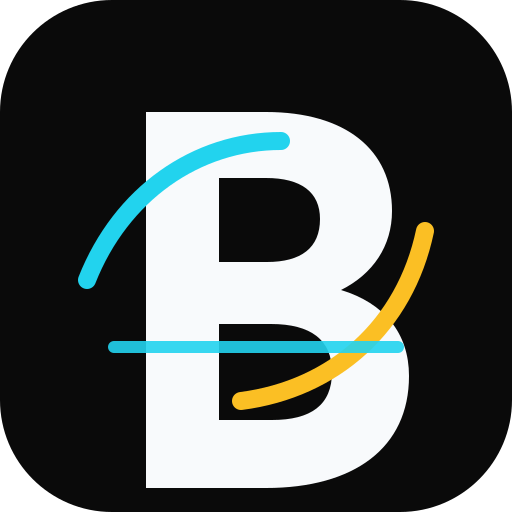

  

<h1 align="center">Bridge</h1>

<strong>CONNECT · SHARE · BEYOND</strong>

One ecosystem. Every device.

Bridge is an open-source, local-first device interoperability project for Windows, Android, and iOS. The goal is to make nearby devices work together through one secure, permission-based ecosystem.

> **Status: early foundation.** Native client shells, a shared Rust protocol/core, explicit-consent pairing state, and a tested Noise XX encrypted-session foundation are in place. Device discovery, network pairing integration, clipboard sync, and file transfer are not implemented yet.

## Platforms

- **Windows:** Native Rust + [egui](https://github.com/emilk/egui) desktop application. No WebView2, Tauri, Electron, Chromium, or embedded browser runtime.
- **Android:** Kotlin + Jetpack Compose.
- **iOS:** SwiftUI native app.
- **Shared engine:** Rust workspace with versioned protocol types, device registry, pairing consent state machine, and encrypted-session primitives.

## Repository layout

- `crates/bridge-protocol` — versioned wire types.
- `crates/bridge-core` — device registry and pairing lifecycle.
- `crates/bridge-security` — Noise XX handshake and authenticated encrypted sessions.
- `apps/desktop` — native Rust + egui Windows desktop app.
- `apps/android` — Android app.
- `apps/ios` — iOS app.
- `docs/` — architecture, protocol, security model, and roadmap.
- `.github/workflows/` — CI and tag-based release automation.

## CI/CD

All compilation, tests, packaging, and releases run in GitHub Actions. No local build is required.

Every push to `main` and every pull request validates Rust and builds:
1. Rust formatting, Clippy, and unit tests.
2. Native Windows desktop executable using egui.
3. Android debug APK.
4. iOS Simulator app.

Push a version tag such as `v0.2.0` to build release assets and publish a GitHub Release automatically.

**Signing note:** Windows output is unsigned, Android release artifacts are unsigned, and iOS archive is unsigned. Store distribution requires signing certificates/provisioning profiles and repository secrets; none are committed to this repository.

## Windows desktop technology

The Windows client is a native Rust desktop application rendered by egui. It does not embed a browser engine and does not depend on Microsoft Edge WebView2 Runtime. The desktop build compiles directly from the Rust crate in `apps/desktop`.

## Security principles

- Pairing must require user approval on both devices.
- Noise XX provides an authenticated key exchange and encrypted transport once the peer's static key has been verified.
- The remote static-key fingerprint must be confirmed/pinned by the pairing layer before a peer is trusted; the security crate does not silently trust first contact.
- Device identities must be revocable.
- Capabilities are independently permissioned.
- Network messages must be versioned, validated, and size-bounded.
- No silent cloud upload or background relay.
- Never commit secrets or signing keys.

The Noise security crate currently provides the cryptographic session primitive; it is not yet wired to network sockets, persistent platform key storage, or the pairing UI.

See [docs/roadmap.md](docs/roadmap.md), [docs/protocol.md](docs/protocol.md), [docs/security-model.md](docs/security-model.md), [CONTRIBUTING.md](CONTRIBUTING.md), and [SECURITY.md](SECURITY.md).

## License

MIT. See [LICENSE](LICENSE).
